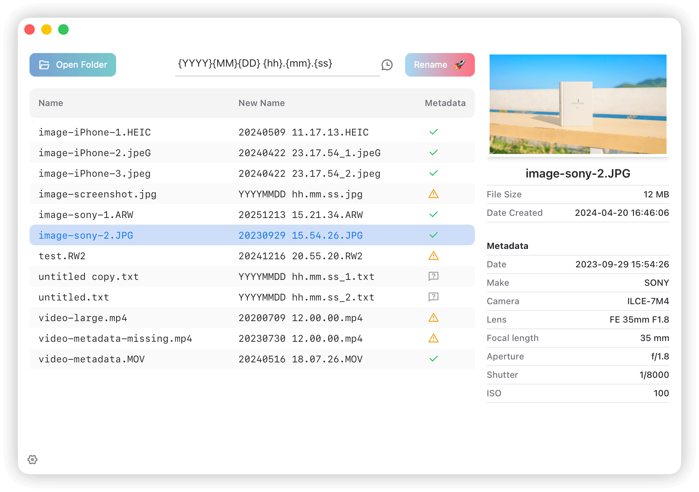

# Rename Photos

Batch rename photos and videos using capture dates, camera information, and custom naming rules. Preview new filenames before applying changes to make media from your phone and camera easier to organize and find.



## Features

- **Metadata-based naming**: Organize photos and videos using capture dates, camera makes and models, and more. Photos can also use lens, focal length, aperture, shutter speed, and ISO information.
- **Custom naming rules**: Combine dates, equipment information, original filenames, and custom text while preserving the original file extensions.
- **Live previews**: Compare original and new filenames as you edit the naming rule, with file details and available capture metadata alongside them.
- **Flexible handling of missing information**: Strict mode skips files that lack the metadata required by your naming rule. You can also choose to use file creation dates for date-based naming.
- **Numbering for duplicate names**: Add sequence numbers to duplicate target filenames detected in the current list, helping distinguish files such as photos taken within the same second.
- **Easy import and reuse**: Open a folder or drag in files or a single folder. The app saves up to five distinct recent naming rules, updating the history after each successful rename.

## Download

Visit [GitHub Releases](https://github.com/Arman19941113/rename-photos/releases/latest) and choose the installer for your operating system and processor:

| Platform                                          | Installer                         |
| ------------------------------------------------- | --------------------------------- |
| macOS · Apple Silicon (M-series chips)            | Filename ends in `_aarch64.dmg`   |
| macOS · Intel                                     | Filename ends in `_x64.dmg`       |
| Windows · x64                                     | Filename ends in `_x64-setup.exe` |
| Linux · x64 (Debian / Ubuntu-based distributions) | Filename ends in `_amd64.deb`     |

macOS requires version 13.3 or later.

Rename Photos is currently distributed without Apple notarization, so macOS may block it after download.

If you downloaded the app from the official GitHub Releases page and trust the source, you can remove the quarantine attribute with:

```bash
sudo xattr -dr com.apple.quarantine "/Applications/Rename Photos.app"
```

## FAQ

### Which photo and video formats are supported?

Metadata reading is supported for JPEG, PNG, WebP, TIFF, HEIC / HEIF, AVIF, and RAW photo formats such as DNG, ARW, CR2 / CR3, NEF, RAF, and RW2. Video formats include MP4, MOV, M4V, 3GP / 3G2, MKV, and WebM.

Available fields depend on the metadata stored in each file and format compatibility. Video naming fields include date, make, and camera model; lens and exposure settings are available only for photos. Image previews and video playback also depend on system support. A file that cannot be previewed may still have readable metadata.

### What if a file has no capture date or other metadata?

By default, missing fields appear as placeholder text in the new filename. When **Strict Mode** is enabled, only files with all the information required by the current naming rule are renamed. Other files keep their original names.

To organize files by their creation time, enable **Use Created Date**. This makes all date variables use the file creation time, rather than using it only as a fallback when the capture date is missing.

Creation-time availability depends on your operating system and filesystem. If it is unavailable, the preview may show a date around 1970. Check the preview before renaming.

### What happens if new filenames are duplicated?

The app adds sequence numbers to duplicate target filenames detected in the current list, but the numbered names may still duplicate other target filenames. Files with the same original name in different folders may also produce incorrect previews. Process folders separately and check the new filenames before renaming.

Before renaming, the app checks for existing paths on disk. If a target name is occupied by a file, directory, or other entry outside the current rename batch, the app reports an error and stops before changing any filenames. This check does not guarantee that all target filenames within the batch are unique.

### Does the app modify photo content or capture metadata?

The app changes filenames in their original folders. It does not re-encode photos or videos or modify embedded metadata such as EXIF.

### Does the app process subfolders? Can I undo a rename?

Opening or dropping a single folder loads only the files directly inside it. Subfolders are not processed recursively. There is currently no built-in undo feature.
