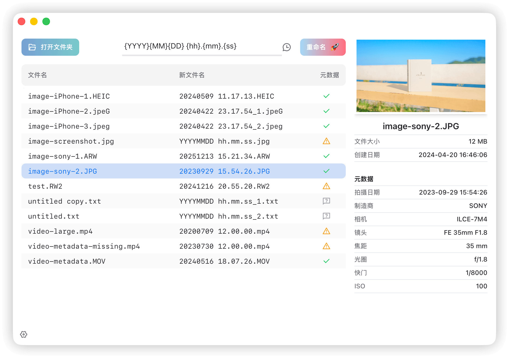

# Rename Photos

根据拍摄时间、相机信息和自定义规则，批量重命名照片与视频。在执行修改前，实时预览新文件名，让手机、相机拍摄的素材更方便整理和查找。



## 核心功能

- **按元数据命名**：使用拍摄日期、相机品牌与型号等信息整理照片和视频；照片还可使用镜头、焦距、光圈、快门和 ISO 等拍摄参数。
- **自定义命名规则**：自由组合日期、设备信息、原文件名和自定义文字，保留原文件扩展名。
- **实时预览**：修改规则时，即时对照原文件名与新文件名，同时查看文件信息和可用的拍摄元数据。
- **灵活处理缺失信息**：严格模式可跳过缺少规则所需元数据的文件；也可选择以文件创建日期作为命名中的日期来源。
- **重复名称编号**：为当前导入列表中检测到的重复目标名称添加序号，便于区分同一秒拍摄的多张照片等情况。
- **便捷导入与复用**：支持打开文件夹、拖入文件或单个文件夹；成功重命名后，保存最近使用的最多五条不同命名规则。

## 下载

前往 [GitHub Releases](https://github.com/Arman19941113/rename-photos/releases/latest)，根据系统和处理器选择安装包：

| 平台                                | 安装包                         |
| ----------------------------------- | ------------------------------ |
| macOS · Apple Silicon（M 系列芯片） | 文件名以 `_aarch64.dmg` 结尾   |
| macOS · Intel                       | 文件名以 `_x64.dmg` 结尾       |
| Windows · x64                       | 文件名以 `_x64-setup.exe` 结尾 |
| Linux · x64（Debian / Ubuntu 系）   | 文件名以 `_amd64.deb` 结尾     |

macOS 需要 13.3 或更高版本。

Rename Photos 目前没有经过 Apple 公证，因此 macOS 可能会在下载后阻止打开。

如果你确认应用来自官方 GitHub Releases 页面，并且信任该来源，可以通过以下命令移除隔离标记：

```bash
sudo xattr -dr com.apple.quarantine "/Applications/Rename Photos.app"
```

## 常见问题

### 支持哪些照片和视频格式？

支持 JPEG、PNG、WebP、TIFF、HEIC / HEIF、AVIF，以及 DNG、ARW、CR2 / CR3、NEF、RAF、RW2 等 RAW 格式的照片元数据读取；视频格式包括 MP4、MOV、M4V、3GP / 3G2、MKV 和 WebM。

能否读取具体字段，取决于文件本身保存的元数据及格式兼容性。视频可用的命名字段为日期、制造商和相机型号，镜头与曝光参数仅适用于照片。界面中的图片预览和视频播放能力还取决于系统支持，无法预览不代表无法读取元数据。

### 没有拍摄日期或其他元数据怎么办？

默认情况下，缺失字段会以占位文字出现在新文件名中。开启**严格模式**后，只有当前命名规则所需信息齐全的文件才会被重命名，其他文件保持原名。

如果希望按文件创建时间整理，可以开启**使用创建日期**。开启后，命名中的所有日期变量都会使用文件创建时间，而不是只在拍摄日期缺失时补用。

文件创建时间是否可读取，取决于系统和文件系统；无法读取时，预览可能出现 1970 年附近的日期，请在执行前确认。

### 新文件名重复时会怎样？

应用会为当前导入列表中检测到的重复目标名称添加序号，但编号后的名称仍可能与其他目标名称重复。不同文件夹中的同名文件也可能出现预览不准确的情况，建议按文件夹分别处理，并在执行前检查新文件名。

执行前，应用会检查磁盘上的已有路径；如果目标名称被本次重命名以外的文件或目录等占用，会在修改任何文件名前报错并停止本次操作。这项检查不保证本次操作内的所有目标名称互不重复。

### 会修改照片内容或拍摄信息吗？

应用在原目录中修改文件名，不重新编码照片或视频，也不改写其中的 EXIF 等元数据。

### 会处理子文件夹吗？支持撤销吗？

打开或拖入单个文件夹时，只读取该文件夹内的直接文件，不递归处理子文件夹。目前没有内置撤销功能。
